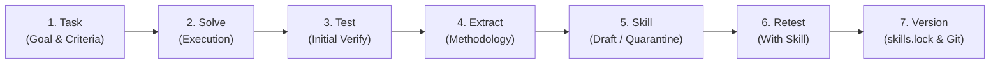

# YusufClaw Python Subsystem: MCP, Rootless Sandbox & Skill Lifecycle

This document describes the implementation of the **Model Context Protocol (MCP)** subsystem, the **Rootless Sandbox Runner with Reversible Action Log**, and the **7-Stage Skill Lifecycle Pipeline** in YusufClaw (branch `py-mcp`), implementing Layers 6 (Skills), 7 (Tools), and 8 (Verification/Sandbox) of `docs/ARCHITECTURE-v2.md` and security controls from `docs/RESEARCH.md` and `docs/RESEARCH-ASIST.md`.

---

## 1. Architectural Summary & Scope Boundaries

### Non-Interference Guarantee
In strict adherence to instructions, existing subsystems were preserved without modification:
- **Untouched files and packages**: `src/yusufclaw/agent.py`, `src/yusufclaw/gateway/`, `src/yusufclaw/security/`, `src/yusufclaw/memory/`, `src/yusufclaw/routines/`, `src/yusufclaw/telemetry/`, `src/yusufclaw/models/`, `infra_py/`, existing files in `src/yusufclaw/tools/*.py`, and `packages/` (TypeScript).
- **Untouched loader**: `src/yusufclaw/skills/loader.py` was **not modified**.
- **100% Offline Testing**: All test suites run completely offline with zero external network or cloud dependencies. MCP tests use a local subprocess stdio server mock; sandbox tests automatically skip backend execution when unprivileged namespaces or container runtimes are unavailable.

---

## 2. MCP Subsystem (`src/yusufclaw/mcp/`)

The MCP package connects YusufClaw to external tools via the official `mcp` Python SDK (version 2.3.0), wrapping them in deterministic security manifests, defense-in-depth pinning, and prompt bloat mitigation.

### Key Components

- **`models.py`**:
  - `MCPServerConfig`: Strongly-typed server configuration supporting `stdio` (command, args, env, cwd) and remote `streamable_http` / `sse` (url, headers). Includes version pinning, `pinned_hash`, quarantine flag, and execution timeout.
  - `MCPConfig`: Global configuration registry with JSON persistence (`from_file`, `save`, `from_dict`).
  - `ServerPinRecord`: Audit entry tracking server version, SHA-256 tools hash, and quarantine status.

- **`pinning.py`**:
  - `canonical_tool_representation` & `compute_tools_hash`: Normalizes tool definitions (name, description, input schema) into canonical JSON sorted by tool name and computes a deterministic SHA-256 digest.
  - `PinningStore`: Backed by `mcp.lock.json` or in-memory.
  - **Tool Poisoning Defense (RESEARCH-ASIST YC-16, MCPTox, ClawSafety)**:
    - If an unpinned server is encountered, it is automatically marked `unverified` and quarantined.
    - If a server's tool hash changes (e.g. description altered in a poisoning attack), it is quarantined with a reason explaining the hash mismatch.
    - `pin_server(name, hash, version)` records trusted status.

- **`client.py`**:
  - `MCPClient`: Unified async client using the official `mcp` SDK.
  - Transports:
    - `stdio`: `mcp.client.stdio.stdio_client` with `StdioServerParameters`.
    - `streamable_http`: `mcp.client.streamable_http.streamable_http_client`.
    - `sse`: `mcp.client.sse.sse_client`.
  - Methods: `list_tools(config)` and `call_tool(config, tool_name, args)` with per-request timeouts and text content extraction.

- **`adapter.py`**:
  - `adapt_mcp_tool`: Adapts raw `mcp.types.Tool` objects into YusufClaw `GuardedTool`:
    - `ToolManifest(id="{server}_{tool}", version=..., source="mcp", effects=["read_untrusted"], description_sha256=...)`.
    - Untrusted Input Tainting: All external MCP output is classified as `read_untrusted`, properly updating session taint in `agent.py`.
    - Fails closed: If the server is in quarantine, calling `execute()` immediately raises `QuarantinedServerError`.
  - `discover_mcp_tools`: Scans configured servers, evaluates tools against `PinningStore`, places unpinned or modified servers into quarantine, and returns only verified `GuardedTool` instances.

- **`selection.py`**:
  - `DynamicToolSelector` & `select_tools_for_query`:
  - **Prompt Bloat Mitigation (RAG-MCP, Gan & Sun 2025, ARCHITECTURE-v2 Layer 7)**:
    - If total tool count $\le 30$ (default threshold), all tools are passed directly.
    - If total tool count $> 30$, dynamically selects top-$k$ (default 10) most relevant tools based on query token matching against tool names, descriptions, and input parameters, while preserving guaranteed tools (`always_include`).

---

## 3. Rootless Sandbox Subsystem (`src/yusufclaw/sandbox/`)

Provides OS-level isolation for shell and code execution tools, enforcing resource constraints, strict network denial by default, and a reversible action log.

### Key Components

- **`models.py`**:
  - `SandboxConfig`: Defines limits:
    - `memory_limit_mb = 512`
    - `cpu_limit = 1.0`
    - `timeout_seconds = 30.0`
    - `max_output_bytes = 65536` (64 KB output truncation)
    - `allow_network = False` (network access disabled by default)
    - `workspace_dir = ".data/workspace"`
    - `read_only_binds`: Host paths mounted read-only.
  - `SandboxResult`: Exit code, stdout, stderr, duration, backend name, and timeout status.
  - `ActionLogEntry` & `UndoResult`: Schemas for append-only reversible action logging.

- **`runner.py`**:
  - `SandboxRunner`: Abstract base class with async (`run_async`) and sync (`run`) execution methods.
  - `BubblewrapRunner` (`bubblewrap`):
    - Uses unprivileged Linux namespaces via `bwrap`.
    - Mounts system binaries read-only (`/usr`, `/lib`, `/lib64`, `/bin`, `/etc/alternatives`), binds workspace read-write, mounts tmpfs `/tmp`, and applies `--unshare-net` (when `allow_network=False`), `--unshare-ipc`, `--unshare-pid`, `--unshare-uts`.
  - `RootlessContainerRunner` (`podman_rootless` / `docker_rootless`):
    - Runs isolated containers with `--network none`, `--memory`, `--cpus`, `--read-only`, and tmpfs `/tmp`.
  - `DeniedFallbackRunner` (`denied_fallback`):
    - **Fail-Closed Security Doctrine (RESEARCH.md, YC-04)**: When no rootless sandbox runtime is installed or usable, execution is denied (exit code 126) rather than silently falling back to the host system.
  - `get_sandbox_runner`: Auto-detects available runtimes in order of preference: Bubblewrap $\rightarrow$ Podman $\rightarrow$ Docker $\rightarrow$ Denied fallback.

- **`action_log.py`**:
  - `ReversibleActionLog`:
    - Persistent, append-only JSONL file (`.yusufclaw_actions.jsonl`).
    - Every mutating action logs an `ActionLogEntry` with UUID, timestamp, tool name, action type, target, details, and `undo_hint`.
    - Supported undo hint types:
      - `delete_file`: Deletes files created by the action.
      - `restore_file`: Restores previous content or copies from backup.
      - `remove_dir`: Removes created directories.
    - Event-Sourced Status Derivation: When `undo()` succeeds, an `undo_action` compensation event is appended. Attempting duplicate undos is rejected.

---

## 4. Skill Lifecycle Subsystem (`src/yusufclaw/skills/lifecycle.py`)

Implements the complete 7-stage skill evolution pipeline (ARCHITECTURE-v2 Layer 6) without modifying `skills/loader.py`.

### 7-Stage Pipeline

1. **`task`**: Creates `TaskSpec` with task ID, description, goal prompt, and acceptance criteria.
2. **`solve`**: Executes task via `solver_fn` producing `TaskSolution` (steps, output, methodology).
3. **`test`**: Evaluates initial solution against acceptance criteria via `verifier_fn` (`VerificationResult`).
4. **`extract`**: Synthesizes a reusable `SkillCandidate` with standardized Agent Skills YAML frontmatter (`name`, `description`, `allowed-tools`, `version`, `resources`) and structured markdown body.
5. **`skill`**: Persists `SKILL.md` to disk in draft/quarantine state (`skills/quarantine/{name}/SKILL.md`) with a canonical SHA-256 hash.
6. **`retest`**: Injects candidate skill into `retest_fn` to verify the task is reliably solved. Retest failure rejects the skill and keeps it quarantined.
7. **`version`**: Promotes skill to active directory (`skills/{name}/SKILL.md`), updates `skills.lock` with SHA-256 fingerprint, and creates a git commit capturing the commit SHA.

### Pinning & Quarantine (`SkillLock`)
- Persistent `skills.lock` file stores `{skill_name: {"hash": sha256, "version": "1.0.0", "status": "active"}}`.
- `verify_skill(name, content)` detects any unauthorized modification (`hash_mismatch`) or unpinned skill (`unpinned`).
- `is_quarantined(name)` ensures unverified or draft skills cannot be executed by the agent.

---

## 5. Verification & Test Suite

All tests run offline via `uv run pytest`:

| Test Suite | Tests | Description |
|---|---|---|
| `test_mcp.py` | 5 | Config parsing, canonical hashing, `PinningStore`, offline mock stdio MCP server discovery/execution, dynamic tool selection ($>30$ tools). |
| `test_sandbox.py` | 7 | Limits defaults, Bubblewrap command building, rootless container command building, denied fail-closed fallback, append-only reversible action log undos (delete, restore, rmdir, non-reversible). |
| `test_skill_lifecycle.py` | 4 | Frontmatter formatting, `SkillLock` tamper detection, 7-stage pipeline end-to-end with git commit, retest failure quarantine. |
| Total Python Test Suite | **120** | **119 passed, 1 skipped** (bwrap skip when unprivileged namespaces restricted), 0 failures. |

### Code Quality Gates
- **Linter**: `uv run ruff check .` $\rightarrow$ 0 errors, 0 warnings.
- **Type Checker**: `uv run mypy src` $\rightarrow$ 0 errors across 60 source files in strict mode.
