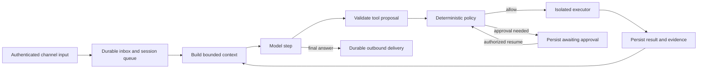

# YusufClaw: personal AI agent research

## Türkçe özet

YusufClaw için önerilen başlangıç mimarisi, **tek bir kalıcı ajan döngüsü, merkezi izin denetimi, SQLite üzerinde izlenebilir bellek ve bütün kanalların paylaştığı bir gateway** yapısıdır. ReAct, araç sonuçlarına göre ilerlemeyi; MemGPT/Letta, sınırlı bağlamı yönetmeyi; OpenClaw, aynı ajana farklı kanallardan erişmeyi; OpenHands ise ajan ile çalıştırma ortamını ayırmayı gösteriyor. Bu yaklaşımları birleştirmek, ilk sürümde çok ajanlı ve kendi kendini değiştiren büyük bir sistem kurmaktan daha yönetilebilir bir başlangıç sunar. Bu son tercih, kaynakların ortak bir deney sonucu değil, SPEC.md için mühendislik önerimizdir.

Bellek yalnızca sohbet geçmişi veya vektör veritabanı değildir. Kısa süreli çalışma bağlamı, olay kayıtları, doğrulanmış kullanıcı bilgileri ve test edilmiş beceriler farklı yaşam döngülerine sahip olmalıdır. Her kalıcı bilgi kaynağına, zamanına, kapsamına ve değişiklik geçmişine bağlanmalı; yanlış bilgi düzeltilebilmeli, unutma isteği arama indekslerine ve türetilmiş özetlere de uygulanmalıdır. A-MEM bağlantılı notlar, Mem0 bilgi çıkarımı, Zep/Graphiti zamansal ilişkiler için yararlı örneklerdir; bunların tamamını ilk sürüme taşımak gerekli değildir.

Araç çağrısı modelin önerisidir; çalıştırma izni değildir. Dosya, shell, tarayıcı, MCP ve alt ajanlar aynı politika katmanından geçmelidir. Prompt injection için yalnızca “bu talimatları dikkate alma” demek yeterli değildir: işletim sistemi seviyesinde izolasyon, ağ erişim sınırları, kaynak etiketleme, dar yetkiler ve somut işlem içeriğine bağlı onay gerekir. Onay, işlem argümanları değiştiğinde veya süresi dolduğunda geçersiz olmalıdır.

**Öncelik sırası:** P0: güvenilir döngü, CLI + Telegram, Bedrock + Ollama, SQLite, izinler ve hata/kurtarma testleri. P1: web arayüzü, hibrit bellek araması, konsolidasyon, kalıcı zamanlanmış işler, kontrollü tarayıcı/MCP. P2: sınırlı alt ajanlar, WhatsApp/e-posta/ses, ölçülmüş ihtiyaç varsa bilgi grafı ve AWS dağıtımı. SPEC.md içindeki “henüz AWS'ye dağıtma” sınırı korunmalıdır. Bedrock API kullanımı, uygulamayı AWS'ye dağıtmakla aynı şey değildir.

Araştırma sırasında önemli güncellik farkları bulundu: Node.js 20 artık EOL; yeni uygulama için desteklenen LTS sürümüne geçiş öneriliyor. Letta'nın ana deposu güncel geliştirmeyi `letta-code` deposuna yönlendiriyor; eski MemGPT/v1 SDK ile güncel harness aynı şey sayılmamalı. MCP'nin güncel resmi sürümü 2026-07-28; eski SDK örneklerini yeni paketlerle karıştırmamak gerekiyor. AutoGPT Platform ile MIT lisanslı Classic bölümü de ayrı değerlendirilmelidir. Ayrıntılı kaynaklar ve uygulama adımları aşağıda ve [DESIGN-RECOMMENDATIONS.md](DESIGN-RECOMMENDATIONS.md) dosyasındadır.

## Scope, evidence, and priorities

Research date: **2026-10-16**. Requirements come from [SPEC.md](SPEC.md): TypeScript/pnpm; `gateway`, `core`, `models`, `tools`, `infra`; Bedrock default using profile `yusufclaw` in `us-east-1`; Ollama and an OpenAI-compatible provider; CLI and Telegram first; local SQLite; later DynamoDB/S3/CDK and heavy workers. This is a design study, not an implementation or a deployed-system audit. “Grok Bot style” is treated as a product interaction reference; the spec identifies no particular Grok Bot repository, so no private architecture is attributed to it.

Sources are primary papers, official documentation, and upstream repositories. Paper titles/identifiers were checked through arXiv; project behavior was checked through documentation and repository READMEs, including direct reads of OpenClaw's architecture/memory documents. Search results from secondary articles and community comparisons were not used as technical evidence. Papers establish techniques within their experimental settings, not guaranteed production reliability. Vendor benchmark claims are not independently reproduced here. URLs on `main`, documentation, and product pages are mutable; pin releases/commits when implementing. Original publication years and the currently observed software are distinguished below.

**Priority definitions:** P0 = required for a trustworthy local Phase 1; P1 = next useful capability after that foundation; P2 = conditional expansion. Priority is our recommendation, not a paper's conclusion. All proposed limits, thresholds, schemas, and algorithms below are design choices unless explicitly attributed.

One proposed spec amendment: choose a supported LTS baseline, currently Node 24, instead of Node 20. Node's official pages classify 20 as EOL and list 24 as LTS. This report does not modify SPEC.md. [Node EOL](https://nodejs.org/en/about/eol), [release status](https://nodejs.org/en/download/archive/v20).

## 1. Architectures and control loops

### Findings from the literature

| Approach | Evidence and mechanism | Limitation for a personal assistant | YusufClaw recommendation |
|---|---|---|---|
| ReAct | Yao et al., *ReAct: Synergizing Reasoning and Acting in Language Models* (2022): alternate reasoning/action with observations. [Paper](https://arxiv.org/abs/2210.03629) | A successful research trajectory does not provide crash recovery, permission checks, or bounded spending. | **P0:** model → validated tool proposal → policy → execution → observation; persist transitions. |
| Reflexion | Shinn et al., *Reflexion: Language Agents with Verbal Reinforcement Learning* (2023): verbal feedback retained across attempts, without updating weights. [Paper](https://arxiv.org/abs/2303.11366) | Self-criticism can be wrong; retrying externally visible operations can duplicate effects. | **P1:** one bounded reflection after verified failure; store a candidate lesson with evidence. |
| Plan-and-execute | Wang et al., *Plan-and-Solve Prompting* (2023) separates planning and solving; Xu et al., *ReWOO* (2023) separates reasoning from observations. [Plan-and-Solve](https://arxiv.org/abs/2305.04091), [ReWOO](https://arxiv.org/abs/2305.18323) | Planning research is not a durable workflow engine. Fixed plans become stale when tools fail or requirements change. | **P1:** checkpointed dependency plan for long tasks; replan after failed prerequisites or new user constraints. |
| Multi-agent orchestration | Wu et al., *AutoGen* (2023) describes configurable agents, conversations, tools, and human participation. [Paper](https://arxiv.org/abs/2308.08155) | Multiple agents add coordination cost, shared-state conflicts, and more paths for untrusted content. | **P2:** parent-owned tasks with bounded workers; no unlimited agent conversation. |
| Durable graph execution | LangGraph JS provides persistence/checkpoint abstractions. [Repository](https://github.com/langchain-ai/langgraphjs), [persistence docs](https://docs.langchain.com/oss/javascript/langgraph/persistence) | A checkpoint does not atomically commit an external API side effect. | **P0 concept; P1 adoption decision:** explicit states and durable operations even if the initial loop is custom. |

Do not require or expose private chain-of-thought to implement ReAct. Persist tool requests, observations, short task plans, policy decisions, and user-facing explanations. Those are sufficient to inspect what the system did. Success must come from tool receipts or task-specific checks, not from the model saying it is finished.

### Recommended loop and concurrency model — P0

Use one authoritative run owner per session. A process-level queue is sufficient for the first daemon, provided SQLite stores accepted work before it is acknowledged. Add leases/fencing before multiple processes can claim a run. CLI and Telegram should be clients of the same owner rather than independent agents writing concurrently to one conversation.

States: `queued`, `running`, `awaiting_approval`, `awaiting_input`, `succeeded`, `failed`, `cancelled`, `outcome_unknown`. Waiting must release execution resources. A reply to an old approval resumes its existing operation; it must not create a fresh unconstrained request.

Give each run limits on model steps, elapsed execution time, tokens/cost, output bytes, and tool duration. Suggested starting defaults: 12 model steps, 120 seconds of active execution for ordinary chat, 30-second tool timeout, at most two retries for transient read failures. These are tunable starting values, not research-backed universal constants. A browser or coding job gets its own explicit budget. Approval waiting time is tracked separately and has an expiry.

Retries need a side-effect ledger: persist an operation ID and normalized request before execution, then record the receipt. If the process dies after a remote action succeeds but before recording it, mark the outcome unknown. Query remote status when possible; otherwise ask for reconciliation. An outbox and idempotency key reduce duplicates but cannot guarantee exactly-once delivery against an API that lacks compatible semantics. Never replay historical shell commands merely to reconstruct a conversation.

### Subagents and local coding delegates — P2

Treat delegation as a tool: `{task, workspace, permittedTools, deadline, maxCost, expectedArtifacts}`. Start with two workers and maximum depth one. Child permissions are the intersection of the parent's grant and the worker profile. A child cannot extend its deadline, read unrelated memory, approve its own actions, or create an external message channel. All child spending counts against the parent budget.

For `agy` and `codex CLI`, introduce executable adapters with version/capability probes. `agy` is not identified precisely in SPEC.md; do not invent its flags or protocol. Pass argument arrays, isolated workspaces, restricted environments, cancellation, and bounded logs. Return artifacts and a structured status, then have the parent verify tests/diffs. A delegate that bypasses the shared approval service must be restricted to a sandbox with no consequential credentials or left disabled. Parallelize independent research or separate worktrees; serialize competing writes.

## 2. Memory dynamics

### Memory is several stores with different authority

| Layer | Content | Lifecycle and retrieval | Priority |
|---|---|---|---|
| Working/short-term | Current request, recent turns, active plan, tool results | Per-run context budget; compact completed spans; preserve unresolved operations | P0 |
| Episodic | What happened, when, to which resource, with what result | Persistent event/episode records; temporal filters and source references | P0 |
| Semantic | Preferences, project facts, relationships, decisions | Versioned claims with validity and provenance; bounded profile plus search | P0 basic; P1 extraction |
| Procedural | Tested skills, tool recipes, recovery procedures | Versioned executable/prompt artifacts with prerequisites and evaluations | P1 |

Short/long-term describes persistence and context placement; episodic/semantic/procedural describes content. They are not interchangeable taxonomies. The transcript is evidence; an extracted fact is an interpretation. A retrieved memory is data, not permission to act.

### Research and systems comparison

**MemGPT → Letta.** Packer et al., *MemGPT: Towards LLMs as Operating Systems* (2023), introduces explicit memory tiers and control flow for moving information into a limited context window. It does not make the context window infinite or guarantee perfect recall. [MemGPT paper](https://arxiv.org/abs/2310.08560).

Letta's v1 memory blocks are named, bounded, always-visible context sections editable through tools. Current `letta-ai/letta` points development to `letta-code`; that harness adds a memory filesystem, versioned context, skills, channels, and scheduled behavior. Keep the original paper, v1 SDK concepts, and current product separate. **Recommendation, P0/P1:** adopt a small editable profile and explicit search/update tools; isolate immutable security policy from editable memory. Evaluate current Letta as an alternative runtime in a spike before deciding to replace the custom core. [v1 blocks](https://docs.letta.com/v1-sdk/memory/memory-blocks), [repository transition](https://github.com/letta-ai/letta), [current harness](https://github.com/letta-ai/letta-code).

**Generative Agents.** Park et al., *Generative Agents: Interactive Simulacra of Human Behavior* (2023), combines a memory stream, retrieval using relevance/recency/importance, reflection, and planning in a simulated social environment. This supports the usefulness of derived reflections, but believable simulated behavior is not evidence of secure real-world automation. **Recommendation, P1:** produce evidence-linked episode summaries and consolidate during idle periods; avoid treating importance scores or reflections as objective facts. [Paper](https://arxiv.org/abs/2304.03442), [code](https://github.com/joonspk-research/generative_agents).

**A-MEM.** Xu et al., *A-MEM: Agentic Memory for LLM Agents* (2025), develops contextualized notes, links between related notes, and memory evolution inspired by Zettelkasten. The system repository explicitly distinguishes itself from the evaluation repository. **Recommendation, P2:** first add explicit `related_to`, `derived_from`, and `supersedes` links in SQLite. Introduce automatic link generation only if relationship-heavy queries improve enough to justify ingestion cost and correction complexity. Self-editing should propose revisions rather than silently overwrite source evidence. [Paper](https://arxiv.org/abs/2502.12110), [system](https://github.com/agiresearch/A-mem), [experiments](https://github.com/WujiangXu/AgenticMemory).

**Mem0.** Chhikara et al., *Mem0: Building Production-Ready AI Agents with Scalable Long-Term Memory* (2025), describes extraction/update of salient memories and a graph-enhanced variant. It is an external memory layer rather than a full substitute for run state, permissions, or message delivery. **Recommendation, P1 experiment:** compare a Mem0 adapter with a transparent local extraction pipeline under identical models, histories, and budgets. Keep canonical facts exportable; configure inference and embedding providers explicitly to preserve the Bedrock/Ollama preference. Do not quote reported relative gains as expected YusufClaw gains. [Paper](https://arxiv.org/abs/2504.19413), [OSS repository](https://github.com/mem0ai/mem0).

**Zep / Graphiti.** Rasmussen et al., *Zep: A Temporal Knowledge Graph Architecture for Agent Memory* (2025), motivates temporal graph memory. Graphiti maintains evolving facts with provenance and temporal validity; its repository distinguishes the OSS framework from Zep's managed infrastructure. **Recommendation, P0 timestamps; P2 graph:** record both when an event/fact was true and when the system learned it. A graph service is justified only by measured entity/relationship queries; it adds a graph backend and operational work beyond a local TypeScript daemon. [Paper](https://arxiv.org/abs/2501.13956), [Graphiti](https://github.com/getzep/graphiti).

### Retrieval pipeline — P0 lexical, P1 hybrid

1. Resolve authenticated principal, project, session scope, and the query's time intent **before** searching.
2. Retrieve exact matches through SQLite FTS5 and structured keys. Identifiers, paths, names, and dates often need lexical matching. [SQLite FTS5](https://www.sqlite.org/fts5.html).
3. Add embeddings behind an interface; record model ID, dimension, normalization, and content hash. A model change requires reindexing or separate indexes, not mixing incompatible vectors.
4. Merge lexical and semantic rankings, for example with reciprocal rank fusion; then apply bounded recency and explicit relevance signals. This is a proposed ranking design. Recency must not bury a stable preference that remains valid.
5. Apply validity/deletion checks again on fetched records, deduplicate, optionally rerank, and fit results into the context budget.
6. Supply memory IDs, dates, source excerpts, and uncertainty to the answer step. Permit abstention when evidence conflicts or is missing.

Evaluate Turkish and English paraphrases, Turkish names, exact code symbols, old-versus-current facts, and cross-session queries. Indexing, retrieval, and answer generation should have separate metrics: a good answer can conceal failed retrieval, and a retrieved fact can still be misread. LongMemEval explicitly studies extraction, multi-session and temporal reasoning, knowledge updates, and abstention. [LongMemEval](https://arxiv.org/abs/2410.10813).

SQLite is the first source of truth; Markdown can be an inspectable export and skills format. Avoid two independently writable authoritative memory stores. FTS5 supplies lexical retrieval, not semantic embeddings. SQLite WAL permits concurrent readers but still requires disciplined write concurrency; keep transactions short and back up consistently with WAL state. [WAL documentation](https://www.sqlite.org/wal.html).

### Consolidation, forgetting, and self-editing — P1

Use `raw event → episode summary → candidate claim → validated durable claim → optional procedural lesson`. Each derivative retains source IDs and a revision number. Extraction runs on completed episodes, not on every streaming token. Consolidation jobs need a watermark and idempotency key; otherwise restart can repeatedly promote the same conversation.

For a profile change, distinguish supersession from contradiction. “I moved to Ankara on June 1” closes a former location's validity interval; it does not prove the user was never in Istanbul. An assistant inference should not overwrite a direct user correction. Conflicting claims remain visible with their sources until resolved. Confidence is not authority, and an LLM confidence number is not calibrated probability.

Forgetting has four separate operations: context eviction, relevance decay, archival retention, and deletion. Eviction does not delete history; decay reduces retrieval rank; supersession preserves historical truth; deletion removes the requested data from active storage and its derivatives. User-pinned facts do not decay automatically. Secrets should never enter semantic memory.

A “forget” operation should mark source records deleted, remove embeddings/FTS entries and dependent summaries, invalidate caches, rebuild affected profile blocks, and prevent deleted material from being reintroduced by delayed jobs. Keep a minimal deletion marker without the deleted content. Define backup expiry and restoration rules; restoring an old backup must reapply later deletion records. Explain that the assistant cannot retract data already sent to an external provider. Full transcript retention is therefore a configurable policy, not an unconditional requirement.

Self-editing tools should support `remember`, `revise(expectedVersion)`, `forget`, and `explainMemory`. Explicit user preferences can be saved immediately within the permitted scope; web-derived statements stay source-labelled. Model-generated procedures start as drafts and require execution tests and review before activation. Neither memory tools nor shell access may rewrite the permission engine or its configuration.

## 3. Tool use, providers, skills, and routines

### Tool learning is distinct from tool execution

Schick et al., *Toolformer: Language Models Can Teach Themselves to Use Tools* (2023), trains models to select and use APIs with self-supervised examples. Patil et al., *Gorilla: Large Language Model Connected with Massive APIs* (2023), studies API-call generation supported by retrieved documentation. Neither provides a production authorization layer. **Recommendation, P0:** use model-native structured tool calling, concise tool schemas, and argument validation; do not begin by training a model. Retrieve only relevant tool descriptions as the catalog grows. [Toolformer](https://arxiv.org/abs/2302.04761), [Gorilla](https://arxiv.org/abs/2305.15334), [Gorilla project](https://github.com/ShishirPatil/gorilla).

Separate three things: the model's function-call representation; the local `Tool` contract; the transport used to reach an external tool. MCP is an integration protocol, not the agent loop or the authority to run a command.

### Provider abstraction — P0

`models` should normalize text deltas, complete tool calls, usage, finish reasons, and errors into an async iterable. Maintain a capability record per configured model: tools, streaming, images, supported schema subset, context limit, and token accounting. Provider compatibility is not equivalent to model capability.

For Bedrock, use client-side tool execution through Converse/ConverseStream where supported, retaining YusufClaw's policy gate. Keep profile `yusufclaw`, region `us-east-1`, and configurable model/inference-profile IDs. Verify access and regional availability during setup rather than assuming a model ID. Do not forward AWS credentials to tools. [Bedrock client-side tool use](https://docs.aws.amazon.com/bedrock/latest/userguide/tool-use-client-side.html), [ConverseStream](https://docs.aws.amazon.com/bedrock/latest/APIReference/API_runtime_ConverseStream.html).

For Ollama, test the selected model's tool calls and streaming behavior; do not assume all locally installed models support tools. For an OpenAI-compatible endpoint, implement a separately tested adapter contract instead of assuming every endpoint shares all semantics. The recommendation concerns protocol compatibility, not a particular OpenAI product. [Ollama tool calling](https://docs.ollama.com/capabilities/tool-calling).

Buffer partial tool arguments until the call is complete, then parse and validate. A malformed JSON prefix must never execute. Keep tool call IDs paired with results across turns. Provider failover must not repeat a tool operation already committed, and local/private conversations must not silently fail over to a cloud provider. Log model IDs and latency; redact sensitive content and credentials.

### MCP — P1, after local tools work

The official current specification resolves to **2026-07-28**, with stateless requests and per-request capability negotiation. The TypeScript SDK's stable v2 uses split client/server packages; its v1 line supports older protocol behavior. Pin an exact SDK release and protocol compatibility matrix rather than combining old tutorials with current imports. For YusufClaw, start with the client, a small server allowlist, and stdio for trusted local processes; add authenticated HTTP servers deliberately. [MCP specification](https://modelcontextprotocol.io/specification/2026-07-28), [TypeScript SDK](https://github.com/modelcontextprotocol/typescript-sdk).

Map MCP tools into the same local executor contract. Namespace by server identity, pin descriptions/schemas or detect changes, validate result sizes, and keep per-server credentials scoped to the server. Treat remote annotations and tool text as untrusted. Disable unsolicited server-driven agent activity unless explicitly supported and policy-checked. Protocol cancellation is not proof a remote side effect stopped; reconcile outcomes. OAuth and protocol trust rules still need application-level permission checks. [MCP security guidance](https://modelcontextprotocol.io/docs/draft/tutorials/security/security_best_practices) (living draft guidance, distinct from the stable protocol).

### Shell, files, browser, and computer use — P0 isolation; P1 browser

Use structured file operations and argument-vector subprocesses for common actions. Arbitrary shell scripts run only inside a restricted executor. A subprocess or JavaScript VM alone is not an OS security boundary. Recommended initial executor: rootless container where supported, dedicated workspace mount, non-root user, dropped capabilities, no privileged mode or Docker socket, no host home directory, resource/process limits, and denied network by default. Keep credentials in a broker outside the sandbox. Stronger isolation may be warranted for fully untrusted code; container hardening is not a proof of escape resistance.

Path checks must account for symlinks and time-of-check/time-of-use changes; sandbox mounts provide an independent limit. Egress restrictions must cover private/loopback/link-local addresses, redirects, DNS resolution, and browser subresources—not only the first URL. Do not let a browser reach cloud instance metadata or local control endpoints.

Prefer APIs over browser automation, accessibility/DOM operations over coordinates, and screenshots only where useful. Playwright MCP exposes browser automation but explicitly says it is not a security boundary. Use a separate browser profile, isolated downloads, no personal cookies by default, bounded page content, and action-specific approval before sending, purchasing, or destructive changes. Browser tool names such as “click” cannot determine risk without the target/action context. [Playwright MCP](https://github.com/microsoft/playwright-mcp).

Desktop computer use adds OS-wide observation and input authority. Defer to a disposable VM or a dedicated desktop environment; do not give Phase 1 the user's active desktop. OSWorld is a useful evaluation environment for this capability, not evidence that arbitrary desktop use is safe. [OSWorld paper](https://arxiv.org/abs/2404.07972).

### Skills and procedural learning — P1

Wang et al., *Voyager: An Open-Ended Embodied Agent with Large Language Models* (2023), combines an automatic curriculum, an executable skill library, and iterative improvement from environment feedback in Minecraft. Transfer the reusable, validated skill idea; do not infer that open-ended personal-life exploration is appropriate. [Paper](https://arxiv.org/abs/2305.16291), [code](https://github.com/MineDojo/Voyager).

Represent a skill as `SKILL.md` plus metadata: ID/version, trigger examples, required tools, allowed resource scopes, prerequisites, instructions, examples, tests, and provenance. Load its short description first, full instructions when selected. A skill cannot grant itself permissions. Reviewed releases are pinned; auto-generated skills stay drafts. Keep executable scripts in the sandbox and route consequential API access through the broker. Measure usefulness by repeatable task success and fewer failed calls, not library size.

### Scheduling and routines — P1

Distinguish a deadline/cron trigger from a heartbeat that asks whether useful work exists. OpenClaw exposes scheduled work separately from conversational memory. **Recommendation:** persist jobs in SQLite, including timezone, schedule expression, next due time, owner, delivery target, skill version, granted capabilities, retry/misfire policy, and budget. A timer wakes the scheduler; the database owns the job. [OpenClaw automations](https://docs.openclaw.ai/automation/cron-jobs).

Use `Europe/Istanbul` as the default from user context, while supporting IANA zones generally. Give each occurrence a stable identity. After sleep/restart, coalesce missed periodic summaries rather than emitting a backlog; explicit reminders can use a different catch-up policy. Prevent overlap through a lease, and cap retries. Future DST tests should use a DST-observing zone even though the configured zone may not change clocks.

Creating or widening a routine's standing authority requires explicit user intent. A daily research summary may use an approved read-only scope and send to its predetermined private target; it does not inherit unlimited shell or message-sending authority. Missing approval means wait/skip with a visible status, never auto-approve because the user is offline.

## 4. Interfaces and multi-channel UX

OpenClaw's architecture documents a long-lived gateway, typed WebSocket requests/events, channel connections, and separate clients/nodes. Its documented event stream is not replayed; clients refresh on gaps. **Recommendation, P0:** borrow centralized ownership and normalized events; for YusufClaw, add durable run-event cursors to support reconnect. That replay behavior is our design choice, not a claimed OpenClaw feature. [Architecture](https://github.com/openclaw/openclaw/blob/main/docs/concepts/architecture.md).

| Surface | Findings / implementation choice | Identity and interaction contract | Priority |
|---|---|---|---|
| CLI | Fastest integration and debugging route; connect to the shared local daemon | Local OS access plus protected socket/token; cancellation and JSON output | P0 |
| Telegram | Bot API supports polling or webhooks; grammY is a TypeScript implementation candidate | Allowlist numeric sender IDs; also constrain chat type/ID; verify callback sender | P0 |
| Web | Shared event stream plus durable transcript/run view | Authenticate before subscription; verify origin; expose approvals and memory history | P1 |
| WhatsApp | OpenClaw uses Baileys; Baileys is a WhatsApp Web library, not Meta's official business API | Isolate session credentials and adapter failure; evaluate account compatibility before choosing | P2 |
| Email | Useful asynchronous input and draft output | Message sender/header is not sufficient authorization; use authenticated account mapping and conservative actions | P2 |
| Voice | Start with push-to-talk transcription and spoken summaries | Show recognized text for consequential actions; interruption stops speech separately from running tools | P2 |

Sources: [Telegram Bot API](https://core.telegram.org/bots/api), [Telegram update FAQ](https://core.telegram.org/bots/faq), [grammY](https://github.com/grammyjs/grammY), [Baileys](https://github.com/WhiskeySockets/Baileys). Meta's Cloud API overview could not be retrieved in this research environment; official WhatsApp eligibility and messaging rules remain an implementation-time verification item. No claims about its current pricing or policy are made here.

For Phase 1 use Telegram long polling: it supports remote commands without exposing an inbound server or deploying AWS resources. Persist the accepted update before advancing the polling offset. Later webhooks should verify Telegram's secret token, durably enqueue, and respond quickly. Deduplicate provider message IDs. Do not run polling and webhook delivery for the same bot simultaneously. [Telegram API](https://core.telegram.org/bots/api).

The normalized envelope should carry `principalId`, `channel`, `externalMessageId`, `conversationId`, `threadId`, `receivedAt`, `replyTarget`, and attachment references. A reply destination is immutable metadata from the authenticated request; a fetched page cannot replace it. Same user identity does not mean all conversations share context. Default to separate channel/thread sessions, then let the user explicitly link them. Share approved profile facts across those sessions while respecting project/private scopes. Group chats never inherit private memory automatically.

Streaming should expose accepted/running/waiting/completed status, safe text deltas, tool progress summaries, and artifact links. Coalesce Telegram edits and obey API rate limits; stream directly to web/CLI with backpressure. Persist semantic events, not necessarily every token. On reconnect supply a snapshot and events after the client's last sequence. Never render tool output as trusted HTML or leak secrets through raw logs.

### Approval UX — P0

Present a concrete action: affected paths, command/arguments, recipient, domain, payload preview or diff, expected effects, and whether it can be undone. The buttons should mean “approve this action once” and “deny”; standing grants require a separate explicit scope. Bind approval to principal, run, tool version, canonical arguments hash, relevant resource version/hash, expiry, and one-time nonce.

Revalidate permission and resource state on resume. A new file hash or changed recipient requires a new proposal. Authenticate callbacks independently of the model. An ordinary message saying “approved” inside a website or tool result is never an approval. `/status`, `/cancel`, `/approvals`, `/memory`, and `/forget` should be deterministic gateway controls. Cancellation prevents future tool dispatch and attempts to stop workers, but cannot promise rollback of an already committed external action.

## 5. Security and permissioning

InjecAgent (Zhan et al., 2024) evaluates indirect injection through tool content; AgentDojo (Debenedetti et al., 2024) supplies tasks, attacks, and defenses in an extensible tool environment. These support treating tool-returned content as an adversarial boundary, not trusting a prompt disclaimer to solve the problem. [InjecAgent](https://arxiv.org/abs/2403.02691), [AgentDojo](https://arxiv.org/abs/2406.13352).

Threat actors include an unknown channel sender, malicious page/document author, compromised MCP server, malicious skill/dependency, and a confused model acting on stale information. Assets include credentials, private memory, local files, authenticated browser sessions, outbound identity, and cloud spending. The intended initial deployment is one trusted owner; it is not a hostile multi-tenant service. OpenClaw likewise documents a personal-assistant trust boundary rather than isolation for mutually hostile users. [OpenClaw security](https://github.com/openclaw/openclaw/blob/main/docs/gateway/security/index.md).

| Attack or failure | Required control outside the model | Test | Priority |
|---|---|---|---|
| Unknown user controls bot | Authenticate/allowlist before creating a run or retrieval query | Unlisted user receives no private context and causes no tool dispatch | P0 |
| Website asks to reveal `.env` | Sandbox excludes secrets; secret broker never returns values; egress policy | Malicious HTML cannot read or transmit a canary secret | P0 |
| Tool description requests extra permissions | Server identity/schema review; permissions from local policy only | Changing description cannot widen grants | P1 before MCP |
| Approval replay or changed payload | One-time nonce, expiry, args/resource binding, atomic consume | Replay and argument mutation are rejected | P0 |
| Shell disguise / symlink escape | Structured args plus OS isolation and constrained mounts | Pipelines, substitutions, and symlink swaps cannot access host secrets | P0 |
| SSRF and metadata theft | Egress proxy/firewall, redirect and DNS checks, private-range denial | Redirects and subresource loads cannot reach internal services | P0 before fetch |
| Cross-session memory leak | Principal/scope filtering before retrieval and after fetch | Private episode absent from group prompt and output | P0 |
| Memory poisoning | Provenance, trust labels, revision review, no policy edits through memory | Injected note cannot create approval or overwrite trusted constraints | P1 |
| Agent amplifies privileges through delegate | Intersect capabilities; broker all consequential actions | Child cannot exceed parent scope or invoke privileged host CLI | P2 before delegation |
| Cost/runaway routine | Deterministic budget accounting, overlap limits, emergency stop | Loop and retry storms terminate within configured bounds | P0/P1 |

Use permission decisions such as `allow`, `deny`, and `require_approval` over structured resources and effects. Read-only is not automatically harmless: reading secrets or fetching internal URLs is sensitive. “Dangerous command” string matching is insufficient because shell syntax and benign-looking tools can express arbitrary effects. Keep approvals at the action boundary even when a plan was approved earlier.

Recommended defense layers: separate instructions from retrieved content; label provenance; minimize exposed context and tools; validate arguments; enforce capabilities and egress; require scoped approvals; isolate execution; keep a redacted audit trail; run adversarial tests. Injection detectors may flag content for review, but must not be the sole permission gate. Security tests should report both attack success and benign task success so that refusing everything does not look like a useful defense.

Secrets from `.env` remain local and uncommitted as required by SPEC.md. Keep restrictive file permissions, scrub environment inheritance to workers, redact logs, and exclude secret files from retrieval and exports. Store references to credentials rather than values in prompts or memory. A sandbox failure must fail closed; do not silently fall back to execution on the gateway host.

## 6. Evaluation benchmarks and a practical test program

| Benchmark | What it measures / source | YusufClaw usage | Limitation and priority |
|---|---|---|---|
| BFCL | Function selection and argument generation. [Berkeley project](https://sky.cs.berkeley.edu/project/berkeley-function-calling-leaderboard/), [code](https://github.com/ShishirPatil/gorilla) | Compare configured Bedrock/Ollama models on relevant schema/tool subsets | Does not validate our sandbox or recoverability; P0 small subset |
| GAIA | General assistant tasks requiring reasoning and tools. Mialon et al. (2023). [Paper](https://arxiv.org/abs/2311.12983) | Research/file task evaluation after basic tools | Live-web changes and model contamination affect comparisons; P1 |
| τ-bench | Tool-agent-user interaction with domain rules. Yao et al. (2024). [Paper](https://arxiv.org/abs/2406.12045), [code](https://github.com/sierra-research/tau-bench) | Repeated trials of policy-aware workflows | Simulated domains differ from personal routines; P1 |
| LoCoMo | Long-conversation QA, summaries, and dialogue tasks. Maharana et al. (2024). [Paper](https://arxiv.org/abs/2402.17753), [code](https://github.com/snap-research/locomo) | Memory ablations with pinned answer/judge models | Synthetic/persona-grounded conversations do not cover all real usage; P1 |
| LongMemEval | Extraction, updates, temporal reasoning, multi-session reasoning, abstention. Wu et al. (2024; ICLR 2025). [Paper](https://arxiv.org/abs/2410.10813), [code](https://github.com/xiaowu0162/LongMemEval) | Primary public memory evaluation | Add deletion, Turkish, access scopes, and poisoning locally; P1 |
| WebArena | Functional browser tasks in reproducible websites. Zhou et al. (2023). [Paper](https://arxiv.org/abs/2307.13854), [code](https://github.com/web-arena-x/webarena) | Browser action and outcome tests | Setup cost; does not reproduce all live sites; P1 subset |
| OSWorld | Execution-based desktop tasks. Xie et al. (2024). [Paper](https://arxiv.org/abs/2404.07972), [code](https://github.com/xlang-ai/OSWorld) | Only when desktop control is proposed | VM cost and environment sensitivity; P2 |
| SWE-bench | Repository issue resolution with tests. Jimenez et al. (2023). [Paper](https://arxiv.org/abs/2310.06770), [code](https://github.com/SWE-bench/SWE-bench) | Evaluate coding delegates on a relevant subset plus our TS fixtures | Original tasks are Python-oriented; not a general assistant score; P2 |
| AgentDojo / InjecAgent | Adversarial tool-content injection. [AgentDojo code](https://github.com/ethz-spylab/agentdojo), [InjecAgent code](https://github.com/uiuc-kang-lab/InjecAgent) | Threat-model fixtures in CI, broader runs periodically | Passing known attacks is not proof against adaptive attacks; P0 fixtures, P1 broader |

Benchmark leaderboard percentages are intentionally not reproduced: differing model versions, tools, judge prompts, budgets, and dataset slices make naïve rankings misleading. A project advertising a strong LoCoMo result is not automatically the best memory backend for YusufClaw.

### Local acceptance suite — P0

Start with at least 40 deterministic scenarios, then add held-out end-to-end tasks in Turkish and English. Cover duplicate Telegram updates; invalid user; malformed/partial tool JSON; model failure; approval denial/expiry/replay; command timeout; crash before and after a side effect; concurrent session requests; path escape; secret exfiltration attempts; memory correction/deletion; and output delivery failure. Assert observable state and denied effects, not exact assistant phrasing.

Measure task completion against explicit artifacts/receipts, unauthorized side effects, duplicate effects, invalid tool-call rate, retrieval recall@k, evidence-supported answer accuracy, stale-fact use, deletion leakage, latency p50/p95, tokens/cost per successful task, and approval burden. Record memory ingestion cost as well as query cost. Report sample size and uncertainty; zero failures on a finite suite is a release condition, not a universal security claim.

For model-based runs pin provider/model IDs, prompts, tool schemas, memory/index versions, data splits, retry rules, and budgets. Repeat nondeterministic tasks several times and report consistent success rather than best-of-many. For τ-style repeated reliability, “all k trials succeeded” is different from pass@k (“at least one succeeded”). Use deterministic checks where possible; calibrate LLM judging on a human-reviewed sample and retain source evidence.

Memory ablations: recent context only → summary only → FTS → FTS+embeddings → extraction/consolidation → optional graph. Architecture ablations: bounded ReAct → planning → reflection → delegation. Change one component at a time under comparable budgets. Keep evaluation questions out of consolidation and skill training.

## 7. Open-source design studies

### OpenClaw: closest gateway/product reference

The documented gateway owns channel connections and exposes typed request/event interfaces to clients and nodes. Its memory design includes Markdown profile/durable notes and dated working notes, with search and optional consolidation mechanisms. These provide a useful separation between stable user context and daily experience. [Repository](https://github.com/openclaw/openclaw), [memory design](https://github.com/openclaw/openclaw/blob/main/docs/concepts/memory.md).

**Adopt, P0/P1:** one gateway owner, adapter boundaries, session identity, typed lifecycle events, inspectable memory, separate scheduled jobs. **Adapt:** use SQLite as canonical state and Markdown export; supply our own durable event replay and tighter initial tool surface. **Defer:** broad device nodes, marketplaces, and many channels. Its extensive feature set and configuration surface are not a Phase 1 checklist. Study the sandbox/security posture explicitly rather than assuming every tool always runs in an isolated environment.

### Letta: strongest memory/runtime comparison

The original MemGPT paper supplies tiered-memory concepts. Current Letta points to a stateful harness with TypeScript-facing development, editable context, skills, channels, and temporal behavior. The v1 SDK remains separately documented. [Current SDK](https://docs.letta.com/agent-sdk), [current harness](https://github.com/letta-ai/letta-code), [legacy repository entrypoint](https://github.com/letta-ai/letta).

**Adopt, P0/P1:** bounded profile blocks, explicit memory tools, revisions and inspectability. **Evaluate, P1:** whether embedding a pinned current Letta runtime reduces maintenance while preserving Bedrock/Ollama and policy requirements. **Do not inherit automatically:** self-modification of the harness, unrestricted cross-agent memory, or operational policy edits. The SDK/runtime choice should be a measured build-versus-adopt experiment, not a decision based solely on the historical Python server.

### OpenHands: strongest execution-boundary reference

Wang et al., *OpenHands: An Open Platform for AI Software Developers as Generalist Agents* (2024), describes an agent platform oriented toward software work. Current repositories separate the Software Agent SDK/Agent Server from applications; the SDK includes Python execution components and a TypeScript client, with local or remote workspaces and typed events. [Paper](https://arxiv.org/abs/2407.16741), [SDK](https://github.com/OpenHands/software-agent-sdk), [architecture](https://github.com/OpenHands/docs/blob/main/sdk/arch/overview.mdx), [application](https://github.com/OpenHands/OpenHands).

**Adopt, P0:** explicit action/observation records and separation of conversation control from workspace execution. **Evaluate, P2:** remote coding worker backend behind a delegate adapter. **Avoid:** importing a full coding platform into the personal gateway solely to obtain a shell. A TypeScript client is not evidence that the whole execution backend runs in Node.

### AutoGPT: autonomous loop history versus current workflow platform

The repository distinguishes the original agent/Forge/benchmark under `classic` from `autogpt_platform`. The platform is organized around building and running agent workflows; this differs from treating AutoGPT only as its early autonomous-loop demo. Its platform code uses Polyform Shield while the rest is MIT. Do not call the entire repository permissively open source or copy platform code under an assumed MIT license. [Repository](https://github.com/Significant-Gravitas/AutoGPT), [license](https://github.com/Significant-Gravitas/AutoGPT/blob/master/LICENSE), [platform overview](https://github.com/Significant-Gravitas/AutoGPT/blob/master/docs/platform/what-is-autogpt-platform.md).

**Adopt as design ideas, P1:** explicit workflow inputs/outputs, reusable components, execution history. **Defer:** visual workflow builder and broad connector marketplace. **Avoid:** indefinite autonomous continuation as a default. YusufClaw routines should be bounded jobs with explicit authority and inspectable completion.

### Build-versus-adopt decision

| Choice | Fit | Recommendation |
|---|---|---|
| Small custom TypeScript core | Direct control of security, local persistence, provider semantics; recovery must be implemented carefully | P0 baseline, using explicit interfaces and a deliberately narrow scope |
| LangGraph JS | Existing checkpoint/graph concepts; dependency and serialization considerations | P1 spike when branching/recovery logic grows |
| Current Letta runtime | Stateful memory and harness features; needs compatibility/security evaluation | P1 alternative spike, not simultaneous second state owner |
| OpenHands worker | Specialized remote software execution | P2 behind delegate boundary |
| Mem0 / Graphiti | Specialized memory services/frameworks | Optional P1/P2 experiments, never prerequisites for local Phase 1 |

## 8. Spec alignment and remaining decisions

Retain the five planned package boundaries. `core` owns runs, memory policy, approvals, and routines; `gateway` authenticates and delivers; `models` normalizes inference; `tools` implements execution behind policy; `infra` stays inactive in Phase 1. Avoid managed-agent orchestration that secretly creates a second loop or memory authority behind the Bedrock provider.

Before a future cloud phase, separate a `StateStore` from `MemoryIndex`: DynamoDB persistence is not a drop-in replacement for SQLite FTS/vector retrieval. Design access patterns, indexes, conditional updates, and migrations explicitly. Long-lived conversations and browser jobs need resumable worker execution; keep webhook request handling short. These are architecture recommendations, not CDK implementation instructions. No infrastructure is deployed by this research.

Decisions still requiring an implementation spike: exact supported Node baseline; selected Bedrock/Ollama models and embedding model; whether current Letta or LangGraph materially reduces maintenance; sandbox availability on the target machine; exact identity/protocol of `agy`; WhatsApp transport; user retention preferences. None blocks writing a local CLI/Telegram core with replaceable adapters.

The actionable sequence, contracts, task IDs, and acceptance gates are in [DESIGN-RECOMMENDATIONS.md](DESIGN-RECOMMENDATIONS.md).
